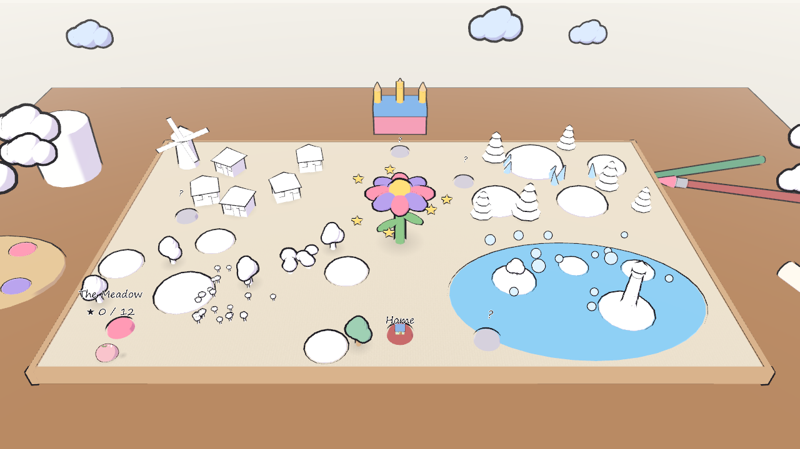
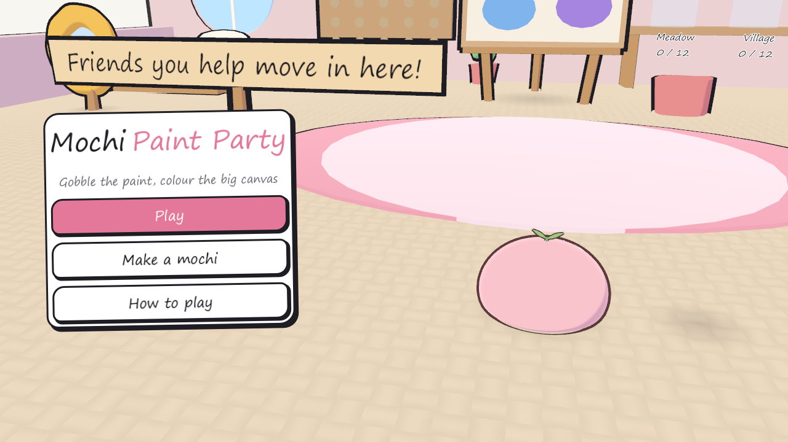
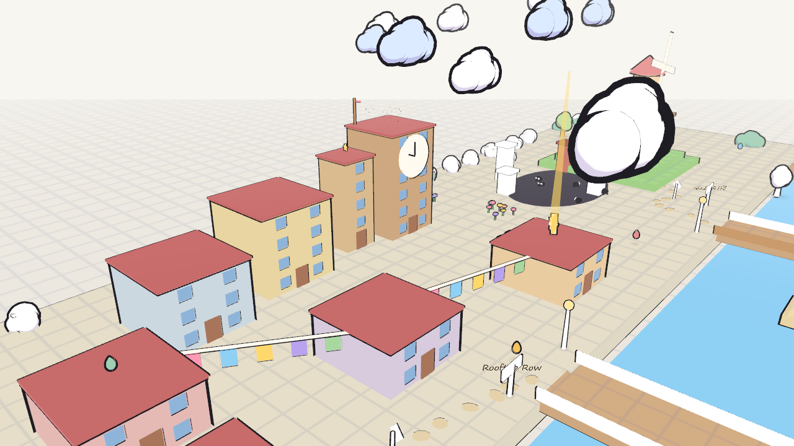
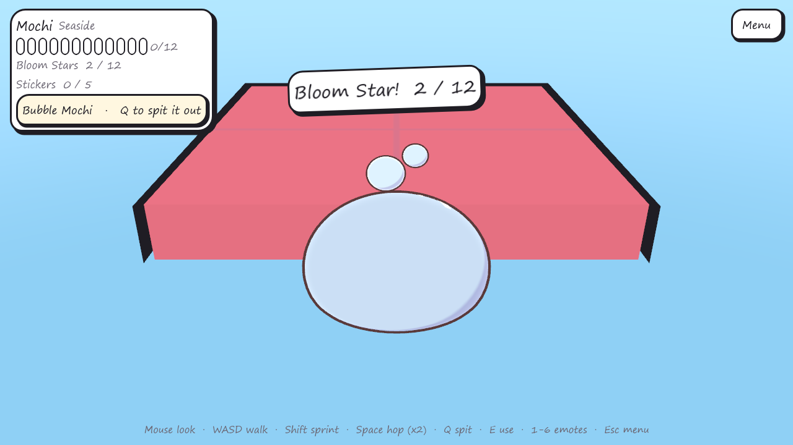
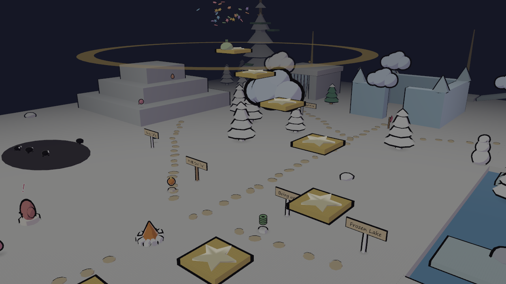

# Mochi Paint Party

A cozy 3D adventure about a squishy mochi on a giant painting canvas that has lost its colour.
Gobble paint drops and doodles to paint each scene back in, borrow the doodles' powers, help the
doodle friends you meet, and finally rub out the Eraser.

| | |
|---|---|
|  |  |
|  |  |

## What's in it

- **Five open scenes** on the Big Canvas: the Meadow, the Village, Seaside, the Snowy Notebook and the
  Eraser's Castle, with **53 Bloom Stars** to find, stickers, paint drops and a final showdown.
- **Six doodle powers**: Puffy (glide), Stone (stomp), Sketch (draw ink bridges), Bubble (walk on water),
  Toasty (melt ice) and Boing (super hops).
- **Doodle friends** with little quests, who move into your studio once you've helped them.
- **Make your own mochi** in the mirror: flavours, eyes, mouths, cheeks and toppings.
- No game over: fall off and you're simply redrawn at the last flag.
- A **level editor** web app (`editor/`) to paint your own scenes on a grid and play them in the game.

## Play it

**Windows (easiest):** go to [Releases](https://github.com/Mainm0e/mochi-paint-party/releases), download
`MochiPaintParty-v1.0-windows.zip`, unzip it and double-click `MochiPaintParty.exe`. No install needed.
If Windows says "Windows protected your PC", click **More info** then **Run anyway** (the game just isn't signed
with a paid certificate).

**From the source** (any system), with [Godot 4.7](https://godotengine.org/) (free):

1. Download Godot 4.7 (standard version) and this repository (green **Code** button → Download ZIP, or `git clone`).
2. Open Godot, choose **Import**, and pick `godot/project.godot`.
3. Press **Play** (F5).

**Controls:** mouse to look, WASD to walk, Shift to sprint, Space to hop (twice in the air),
Q to spit out a power, E to use / talk, left click to draw (Sketch Mochi), 1-6 for emotes, Esc for the menu.
A gamepad works too.

## How it's made

Everything is built from code and original data: no store-bought or third-party art, music or sounds.

- `godot/` — the game (GDScript). The scenes are built in code in `godot/scripts/world.gd`.
- `blender/make_mochi.py` — builds the rigged mochi model, its face layers and emote animations in Blender.
- `tools/make_audio.py`, `tools/make_music.py` — synthesize every sound effect and the six music loops.
- `editor/` — the grid level editor (`node editor/serve.mjs`, then open http://localhost:5175).
- `docs/` — the game design and level design plans.

Made by mainm, with the help of Claude (an AI assistant) for code, art, music and design.

## License

All rights reserved: you may download and play the game, but not reuse its code, characters, art or music.
See [LICENSE](LICENSE).
