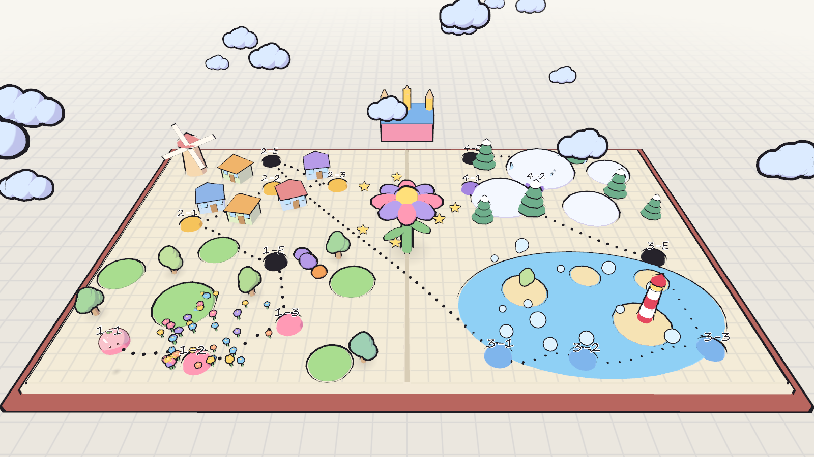

# Mochi Sketchbook: Game Design

*Status: first draft, 2026-11-01. Direction chosen: **Sketchbook Adventure**, casual with some challenge, PC (Windows) first.*

## Pitch

A squishy mochi hops through a sketchbook whose colors have been rubbed out. **Eat** the ink drops and doodles you find to bring the color back, and to borrow their powers: swallow a cloud to float, a pebble to stomp, a pencil to draw yourself a bridge. Every page is a little hand-drawn level to explore; finish it to color it in for good, and bring souvenirs back to your own home page.

## Design pillars

1. **Eat everything.** The big-mouth inhale is the core verb. It collects, it solves puzzles, it gives powers, it cleans up enemies. If a new feature doesn't involve the mouth, ask why.
2. **Ink and paper.** The world is a living sketchbook: white paper, black ink lines, color appears only where you have restored it. Effects and UI stay hand-drawn.
3. **Cozy on the surface, tricky underneath.** Anyone can finish a page; finding every secret, sticker and time trial takes skill. Failing never costs more than a few seconds.
4. **It's *your* mochi.** The creator look follows you everywhere, its face shows how it feels (tired, full, scared), and powers change its look in fun ways.

## Core loop

```
Home Page ──pick a page──▶ Explore page ──▶ eat ink & doodles ──▶ use powers to reach new areas
    ▲                                                                       │
    └── bring back stickers, decorate, change look ◀── reach the Paint Seal ◀┘
```

- **In a page (10–20 min):** explore → inhale paint drops (main goal) and doodles (powers) → overcome a few small platforming/puzzle spots → find hidden stickers → eat the **Paint Seal** at the end to color the whole page.
- **Between pages:** the **Home Page** hub, where you decorate with stickers, change your mochi's look and meet doodle friends you rescued.

## Moment to moment (already built ✓ / planned ○)

| Verb | Feel | Status |
|---|---|---|
| Walk / hop-walk | bouncy "boing" steps | ✓ |
| Sprint (Shift) | faster, uses stamina, tired face when empty | ✓ |
| Hop + double jump | twirl on the second jump, costs stamina | ✓ |
| Inhale + gulp | giant mouth, things fly in, chomp and chew | ✓ (paint drops only) |
| Emotes 1–6 | cute reactions, also used by doodle friends | ✓ |
| **Spit** | spit the last thing eaten as a bouncing projectile (hit switches, knock off Smudgies) | ○ |
| **Doodle powers** | swallow a power doodle to change form for a while (see below) | ○ |

### Doodle powers ("flavors")

Eating a power doodle changes your mochi's *flavor*: its color, a small accessory and one new ability, until you spit it out or eat another. Mochi-themed, not borrowed from other games.

| Eat | Becomes | Ability | Used for |
|---|---|---|---|
| Cloud | **Puffy Mochi** (white, soft fluff) | slow glide while holding jump | crossing gaps, floating up drafts |
| Pebble | **Stone Mochi** (gray, heavy) | ground pound, sinks, can't be pushed | switches, cracked floors, windy spots |
| Pencil | **Sketch Mochi** (yellow, pencil tip hat) | draw a short ink bridge / ramp in front | gaps, reaching ledges |
| Ember | **Toasty Mochi** (golden, grilled marks) | puffs up big like grilled mochi, melts ice, bumps blocks | ice, crates |
| Spring | **Boing Mochi** (springy coil) | charged super jump | tall ledges, secrets |
| Bubble | **Bubble Mochi** (shiny blue) | float in water, bounce on surfaces | water pages |

Start with **Puffy** and **Stone** in the first chapter; add one or two per chapter after.

## Challenge without frustration

- **No game over.** Falling off the page or into ink: the mochi gets "redrawn" at the last checkpoint (a pencil sketch fills it back in), losing nothing collected.
- **Stamina** is the main skill resource: sprint and double jump spend it, so routes and secrets reward planning.
- **Smudgies:** little ink-blot critters that wander and smear paths. Bump into one and you're knocked back (no health bar); **eat** one to clean it (gives a tiny drop of color).
- **The Eraser:** the gentle antagonist who rubs pages blank. Appears in set pieces (erasing a bridge behind you) and in each chapter's final page.
- **Optional mastery:** hidden stickers, a "spotless" bonus for eating every Smudgie, and a ribbon for finishing a page under a target time.

## Structure and progression

- **The Book:** chapters of 3 pages plus an Eraser page. First four chapters: Meadow (grass, flowers), Village (rooftops, chimneys), Seaside (water, bubbles), Snowy Notebook (ice, toasty puzzles).
- **Paint Seal:** each page ends in a big ink-locked seal; eating it colors the page and unlocks the next one.
- **Stickers:** 5 hidden per page. They unlock new creator items (toppings, eyes, mouths) and home decorations.
- **Doodle friends:** each chapter frees a doodle NPC who moves to the Home Page, chats, gives hints and reacts to your emotes.
- **Home Page:** your hub page. Decorate with earned stickers, re-dress your mochi in the creator, see friends, pick a page from the book.

## World design



Concept renders in [world_concept/](world_concept/) (overview, each chapter, the Ink Bloom and the castle). Rebuild them
with `"$G" --path godot --resolution 1600x900 -- --worldmap=<abs dir>`; the diorama is `_build_worldmap()` in `world.gd`.

### The Book Map

The overworld is the sketchbook itself, lying open. Each chapter is a region drawn across its pages; you walk your
mochi around the map freely (not only node to node), and **level stamps** are joined by dotted ink paths.

- Paths draw themselves in when a page is painted; painting a page fully can reveal **secret paths** to bonus stamps.
- **The Ink Bloom**, a giant living flower, grows from the crease in the middle; it opens up as chapters are finished.
- **The Eraser's castle** stands beyond the top edge of the book: a big pink eraser with pencil towers. It opens
  once enough Bloom Stars are collected.

### Wonder moments: Ink Blooms

Inspired by how the best platformers surprise you halfway through a level, but built from our own idea:

- Each level hides one **Bloom Doodle**, a glowing doodle that is hard to miss but tricky to reach.
- **Eat it, and the page comes alive for a while.** The rules of the level change: the music shifts, colors run
  wild, and the mochi's face reacts. Clear the Bloom challenge to earn a **Bloom Star**.
- Bloom Stars are the main progression collectible (paint drops color the page; stickers are secrets; Bloom Stars
  open new chapters and the castle).

### Chapters

| Chapter | Look | New power | Level ideas | Its Ink Bloom |
|---|---|---|---|---|
| 1. Meadow | rolling hills, flowers, mushrooms | Puffy, Stone | gaps, switches, Smudgie herds | flowers stretch into giant bouncy trampolines that hum a tune; the grass rolls like waves |
| 2. Village | rooftops, chimneys, laundry lines, a windmill | Sketch (draw bridges) | rooftop runs, windmill platforms | the houses stand up on little legs and march, turning into moving staircases |
| 3. Seaside | painted sea, islets, bubbles, a lighthouse | Bubble | tides, bubble rides, lighthouse beam | the page tilts and the sea pours sideways: swim through falling water |
| 4. Snowy Notebook | snow mounds, pines, ice crystals | Toasty, Boing | slippery slopes, ice to melt | night falls and the constellations become paths in the sky |
| The Eraser's castle | eraser blocks, pencil towers, blank paper | (all) | a page that rubs itself out behind you | the Eraser itself, in a final chase |

### Level design rules

1. **One idea per level:** introduce it safely, develop it, twist it, then a finale that tests it.
2. **Short and dense:** 5–10 minutes on a first run, a surprise every minute or so.
3. **Readable at a glance:** a bright landmark always shows where to head; the Paint Seal is visible early.
4. **Curiosity pays:** stickers off the main path, a Bloom Doodle in a spot that makes you ask "how do I get there?".
5. **Gentle failure:** generous checkpoint flags, instant redraws, nothing lost.

## Session and audience

- Cozy-looking but with real platforming and secrets: aimed at casual players who like a bit of challenge.
- A page takes 10–20 minutes on a first pass; finding everything takes longer.
- PC (Windows) first: mouse + keyboard and gamepad. Save after every page and at checkpoints.

## Look and sound

- Look: white paper, faint grid, black ink outlines with a slight wobble, flat two-tone shading; color appears only where restored. The mochi stays pastel and outlined.
- UI: hand-drawn paper cards with ink borders, a handwriting font, thought clouds for character feedback (no bars where a face can say it).
- Sound: soft music-box music, a variation per chapter; bouncy, round effects (boing, slurp, gulp, nom).

## First milestone: a playable slice

Goal: one page that shows the whole loop.

1. **Spit** what you ate (projectile + bounce).
2. **Doodle powers** framework + **Puffy** (glide) and **Stone** (ground pound).
3. One **hand-built page** (Meadow 1) with gaps, a ledge that needs Puffy, a switch that needs Stone, 8 paint drops, 5 stickers, a Paint Seal at the end.
4. **Smudgies** (wander, knockback, can be eaten).
5. **Checkpoints and redraw** on falling.
6. **Home Page** stub: a book to pick the page, the creator, a sticker count.

After the slice: playtest, then the Eraser, more pages, doodle friends and decorating.

**Slice status (built in `godot/`):** all six items are in. Spit is a straight star shot (no bounce yet).
Controls: Q / right-click spit, E use, Space in the air = double jump, glide (Puffy, hold) or stomp (Stone).
The playthrough can be replayed with `-- --autotest=<dir>` (see `scripts/main.gd`).

## Open questions

- Should the camera stay free (current) or get a fixed "storybook" angle on some pages?
- How long should a power last: until you spit it, or on a timer?
- Do stickers unlock creator items only, home decorations, or both?
- ~~Title~~: decided, the game is called **Mochi Sketchbook** (it was "Doodle Mochi").
